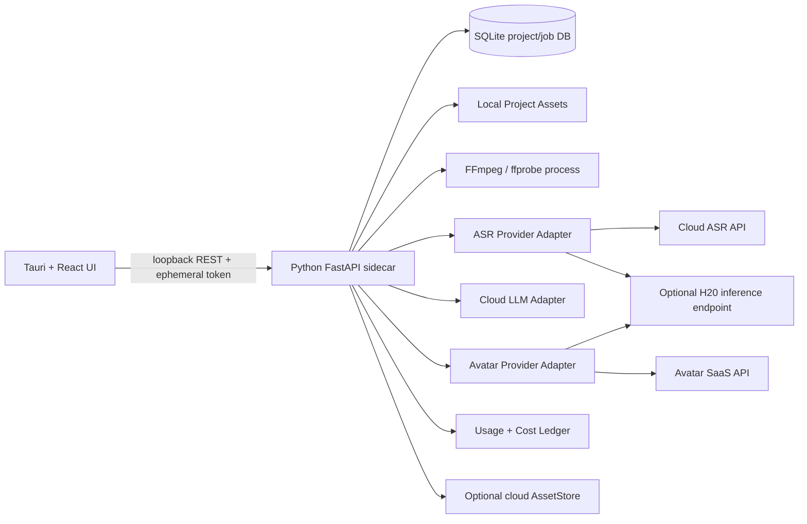
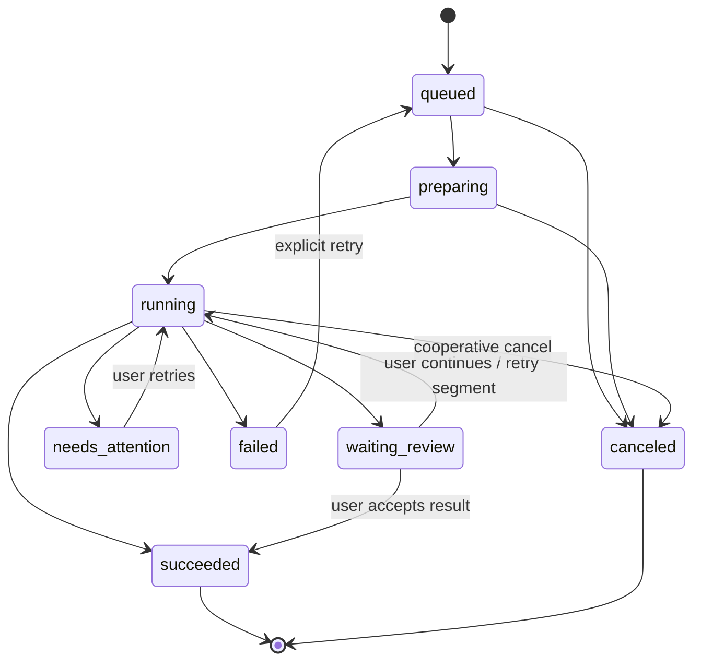

# Windows AI 口播自动剪辑与个人数字人桌面软件
## 开发实施 Spec（面向 AI 编程 Agent）

**版本：** SPEC v1.1（第二轮视频剪辑开源调研增补）  
**日期：** 2026-10-11  
**上游需求：** `Windows_AI口播剪辑与个人数字人软件_PRD_MVP_v1.0.md`  
**用途：** 作为 Codex / Claude Code / Cursor 等 AI 编程 Agent 的实施基线。  
**状态：** 可启动 Phase 0 技术验证；Avatar/ASR Provider 在 POC Gate 通过前不得锁定。第二轮视频剪辑开源评估已加入附录式规范，冲突时以本版“第二轮决策覆盖项”为准。

> 本 Spec 将产品范围冻结为 PRD v1.0，并给出推荐架构、契约、任务拆分、测试与验收门槛。对于数字人生成效果、模型权重许可、H20 性能和云 API 费用，必须实测或核验，不得把宣传材料写成保证。调研核对日期为 2026-10-11；仓库、模型卡与供应商计费均可能变化。

## 目录

- Agent 工作指令
- 目标、范围与不做事项
- 推荐架构与决策边界
- 开源与供应商组件选择表
- 代码库目录规范
- 领域数据模型
- 本地 API 契约
- LLM 剪辑决策契约
- Avatar Provider 契约
- 任务状态机、检查点与恢复
- 安全、隐私与数据删除
- 成本记录与估算
- 错误码与用户提示
- 测试策略与数据
- 分阶段开发任务与 Definition of Done
- ADR 记录
- P2 路线
- 参考资料

---

## 0. Agent 工作指令（必须遵循）

1. 开始前阅读完整上游 PRD；PRD 是产品行为的唯一上游基线。本 Spec 可补足工程细节，但不得静默扩大产品范围。
2. **先执行 Phase 0 POC，再开始完整 UI 实现。** POC 的首要风险是中文 ASR/字级时间戳、个人音色克隆、数字人身份/口型/上半身稳定性、分段一致性、API 实际成本和具体权重许可。
3. POC 期间允许创建隔离的 `experiments/`，但不得把未经通过基准测试的实验代码直接当作产品实现。
4. 所有模型/第三方二进制必须在 `THIRD_PARTY_NOTICES.md` 登记其源 URL、版本或 commit、代码许可证、模型/权重许可证、依赖许可证、下载日期和文件 SHA-256。**仓库代码许可证不等于模型权重/数据集/依赖许可证。** 若权重许可证未确认，禁止把该权重放入发行包或自动下载流程。
5. 用户要求 LLM 调用全部走云端 API。不得在本机或 H20 部署 LLM 来绕过这一决定。ASR、VAD、TTS、数字人推理由 POC 结果决定，可以云端、H20 或混合。
6. 真人素材只允许按原顺序删减。不得重排片段、重写原话、合成替换原声。编辑转写文字不等于编辑音频；字幕修改不应改变原声音轨。
7. 低置信度/含义不确定的删剪建议默认不应用，必须保留原始内容并标记待确认。快速模式也不能静默删除这类片段。
8. 数字人严重质量问题由用户人工判断并决定是否重试。MVP 不需要自动质量评分/自动重试循环。
9. H20 只可作为可选、间歇性远程推理资源，不能成为 App 启动或核心 UI 的硬依赖。云端 Provider 可用时应能在没有 H20 的情况下完成核心流程。
10. 每个阶段结束必须运行测试、更新开发说明与决策记录。未经用户批准，不得扩展到多数字人、完整多轨时间线、自动 B-roll、复杂字幕动画或跨平台支持。

### 0.1 完成任务时的汇报格式

每个 issue/任务完成后，Agent 必须汇报：改动文件、实现内容、运行过的测试及结果、未完成项、涉及的许可证/供应商变化、可能的回归风险。不得只声称“已实现”而没有测试输出。

---

## 1. 目标、范围与不做事项

### 1.1 MVP 必须实现

- Windows 桌面应用；一个本地用户；本地可重新打开的完整工程。
- 真人口播：MP4/MOV 导入，中文普通话转写与时间戳，保守/标准/激进三档删剪建议，待确认标记、接受/拒绝、撤销/恢复、预览、转写/字幕修正。
- 真人素材只删除原片段，不重排、不重写；保留片段的媒体顺序严格单调递增。
- 统一导出：横屏或竖屏由用户手动选择；裁切或模糊背景填充二选一；1080p MP4；嵌入式字幕；基础字幕字体、字号、颜色、位置设置。
- 数字人：首版一个身份；录入本人/有明确授权的参考素材；先生成短测试片；人工批准后启用；中文文案有语气、语速、专有词发音和段落控制；分段生成、合并、人工预览及局部重试。
- 数字人质量检查首版完全人工；重点检查身份相似度、声音相似度、口型同步、视频伪影和音频段落衔接。
- 同一后期链路适用于真人口播与数字人视频。
- 单任务执行、可预提交队列；持久化任务状态，重新打开 App 后恢复查看和可恢复步骤。
- API 费用估算和实际可获取的用量/金额记录。
- 云端数据按类别配置保留规则；可以删除项目或数字人身份资料。删除身份不自动删除已导出成片和普通项目记录，并明确标记旧项目无法再使用已删除身份重新生成。

### 1.2 首版不做

- 多身份管理、多人协作、账号/订阅/支付系统。
- 完整专业多轨时间线编辑器。
- 真人口播改写、重排、自动配音替换。
- 自动数字人质量打分、无上限自动重试。
- 自动 B-roll 选择/生成（列为 P2 可选）。
- 动态逐字字幕动画、多语言数字人、4K 导出、跨设备工程迁移。
- H20 必须在线才能启动或完成任务。

---

## 2. 推荐架构与决策边界

### 2.1 推荐架构（待 POC 验证具体模型 Provider）

- **桌面外壳：Tauri v2 + React + TypeScript。** 体积与内存基线通常比 Electron 轻；Tauri v2 官方 shell plugin 支持 sidecar 子进程。必须使用最小化 capability/allowlist；WebView 不可以直接取得任意文件系统权限。
- **本机编排服务：Python + FastAPI + Pydantic。** 通过 Tauri sidecar 方式运行；负责项目、任务、剪辑策略、Provider Adapter、SQLite、FFmpeg 子进程和日志。与 UI 以仅监听 `127.0.0.1` 的随机端口通信，并由启动握手生成一次性本地 bearer token；不得监听 `0.0.0.0`。
- **数据持久化：SQLite + SQLAlchemy 2.x。** 使用事务、迁移、WAL；媒体文件不存 BLOB，而在项目目录以相对路径引用。
- **音视频：FFmpeg/ffprobe CLI。** 直接调用命令行参数数组，不通过 shell 拼接路径。MoviePy 不是必需依赖；只有能证明显著缩短开发且不增加故障面时再纳入。
- **ASR：Provider Adapter。** Phase 0 比较云 ASR、`faster-whisper` 与 Qwen3-ASR/对齐器（有 H20 时）。选择实际普通话口播测试集上满足时间戳/转写指标且总成本可接受的方案。不能只因仓库有星数而锁定。
- **LLM：云端 API Provider Adapter。** 只负责根据分段转写和上下文提出删剪建议；输出严格结构化 JSON。LLM 不拥有最终删剪权，不直接指定未对齐的自由时间戳。
- **数字人：AvatarProvider Adapter。** POC 比较可用的商用 API 与开源组合 `Qwen3-TTS/OpenVoice + MuseTalk`。商用自定义 Digital Twin 的 API 访问权与价格需实测/询价；开源路径需证明音色、脸部一致性、口型、分段一致性和许可均符合要求。未达到门槛时优先采用通过验收的云服务，不要以 SadTalker 或唇形模型自动等同于完整数字人。
- **可选 H20：RemoteInferenceProvider。** 仅对有性价比的 ASR/TTS/数字人推理任务使用；远程服务有独立版本号、鉴权、健康检查和请求超时。远程服务器不能保存永久唯一的项目状态；任务真相以本地 SQLite 为准。
- **云端历史/中间文件：AssetStore Adapter。** 先支持 Provider 原生 job/file history；如供应商不能满足分类保存/删除，再通过用户自配置的 S3-compatible 存储补齐。不得默认部署自有公网后端或承诺供应商没有提供的删除能力。

### 2.2 架构图



### 2.3 Provider 选择的硬门禁

1. **ASR Gate：** 使用至少 30 个普通话测试片段（含专业名词、口头禅、停顿、快速语速、轻微噪音），人工校验参考文本与关键词起止。至少报告 CER/WER、边界误差分布、吞吐速度、内存/显存和单分钟成本。若模型无法稳定为短句给出合理边界，不得支持自动剪切，只可标注整句人工确认。
2. **Avatar Gate：** 用同一个本人授权素材和同一组不少于 3 段、覆盖数字/英文缩写/标点停顿的 30–60 秒中文测试文案，对比至少一个可申请使用的云 API 和一个可本地自部署组合（如许可与部署条件可行）。人工盲评脸部相似、声音相似、口型、伪影、段落衔接。单一短 demo 不足以通过 Gate。
3. **License Gate：** 代码、权重、声学模型、面部检测/识别模型、配套数据和容器基础镜像逐项记录。许可证不明的候选只能在隔离研究环境测试，不得进入发行包。
4. **Cost Gate：** 以输出成片分钟数为口径，记录创建/建档的固定成本、每分钟生成成本、重试成本、存储/下载流量和人工维护成本。用 30/150/450 分钟/月测算，不以“免费开源”直接视为零成本。

### 2.4 备选桌面外壳

- **Electron + React + TypeScript：** 如果 Tauri sidecar 与 Windows 打包/更新问题明显影响开发进度，可以改用 Electron；其生态成熟但运行包和内存通常更大。必须启用 context isolation、sandbox、禁用 renderer Node integration、严格 CSP，并只暴露窄范围 IPC。
- **纯 PySide6/Qt：** 作为备选，适合 Python-heavy UI，但应先确认文本编辑器、字幕预览、媒体播放控件和打包过程是否好于 Tauri；不允许在未做小型技术原型时同时实现多套 UI。

Agent 不得在没有 ADR 的情况下把桌面架构从推荐方案切换到其他技术栈。

---

## 3. 开源与供应商组件选择表

| 组件/候选 | 官方来源 | 当前调研结论 | 许可/风险提示 | 用途决策 |
|---|---|---|---|---|
| Tauri v2 | https://github.com/tauri-apps/tauri | 轻量桌面外壳；官方 sidecar 机制可运行 Python 服务和 FFmpeg | 核对 Tauri、plugins 与 bundled binaries 各自许可证 | 推荐主方案 |
| Electron | https://github.com/electron/electron | 生态成熟；官方安全文档要求隔离 renderer 权限并保持版本更新 | MIT 不代表所有依赖自动兼容；安全面与包体更大 | 备选，不与 Tauri 并行实现 |
| FFmpeg | https://github.com/FFmpeg/FFmpeg/blob/master/LICENSE.md | 适合 probe、精准剪辑、裁切、模糊背景、字幕硬烧录和 MP4 导出 | 默认多数 LGPL；启用 GPL 组件或使用 x264/libass 等编译组合可能改变发行义务。必须审核实际二进制 build config | P0 必需；发行版二进制须合规审查 |
| faster-whisper | https://github.com/SYSTRAN/faster-whisper | 基于 CTranslate2；支持词级 timestamps 和 VAD filter，适于 POC | 仓库 MIT；Whisper 模型权重、依赖和模型版本仍需登记 | ASR 候选 |
| WhisperX | https://github.com/m-bain/whisperX | 词级时间戳/强制对齐；可作为边界精修候选 | BSD-2-Clause；其对齐模型、VAD、speaker diarization 模型各自核验；中文对齐质量需实测 | 候选，不是强制依赖 |
| OpenAI Whisper | https://github.com/openai/whisper | 多语种识别基线；中文支持好但标准实现较重 | 代码 MIT；锁定权重版本并记录 hash | 对照基线，不默认用原始实现 |
| Qwen3-ASR | https://github.com/QwenLM/Qwen3-ASR | 官方代码 Apache-2.0；仓库包含 ASR 与 forced aligner 接口，是值得测试的中文候选 | 单独核验实际模型卡/权重许可、显存和 Windows/Linux/H20 环境 | H20 ASR/对齐候选 |
| Silero VAD | https://github.com/snakers4/silero-vad | 轻量语音活动检测；能找静音，但不能判断某段语义上是否应该删除 | 仓库 MIT；模型权重版本需固定 | 推荐辅助使用 |
| OpenChatCut | https://github.com/0xsline/OpenChatCut | 含 AI 视频编辑思路，但面向更复杂时间线工作流 | AGPL-3.0；直接复用/派生可能产生强 copyleft 义务 | 不直接集成；只可参考通用交互设计 |
| MoviePy | https://github.com/Zulko/moviepy | Python 视频处理封装，易用但非必要 | MIT；底层 FFmpeg 与发行二进制许可独立审核 | MVP 不引入，优先直接用 FFmpeg |
| MuseTalk | https://github.com/TMElyralab/MuseTalk | 主定位为音频驱动的口型/脸部视频生成；官方 README 声明代码 MIT、训练模型可商用，但依赖模型须分别合规 | 不是完整的音色克隆与身份建档系统；需验证真人参考视频、时长扩展、上半身稳定性 | 开源数字人链路的 POC 候选 |
| Qwen3-TTS | https://github.com/QwenLM/Qwen3-TTS | 2026 代际官方 TTS 项目，提供声音克隆/语音生成方向的实现 | 官方代码标注 Apache-2.0；必须核验所选 checkpoint 的具体模型卡/权重条款 | 开源语音克隆 POC 候选 |
| OpenVoice | https://github.com/myshell-ai/OpenVoice | 官方 README 声明 V1/V2 MIT，V2 提及中文与可控风格 | 需要搭配基础 TTS/声码器；对合成中文自然度及依赖模型逐项验证 | TTS/声音风格备选 |
| Coqui XTTS-v2 | https://github.com/coqui-ai/TTS | 有多语言声音克隆能力 | XTTS-v2 模型标为 CPML 且要求接受条款；不应把仓库代码许可证当模型权重许可证 | 不作为默认集成，除非授权审查通过 |
| ChatTTS | https://github.com/2noise/ChatTTS | 中文生成和表达效果可研究 | 代码、权重、训练数据和使用条款分别核验；未完成许可审核前不得打包 | 实验候选 |
| Wav2Lip | https://github.com/Rudrabha/Wav2Lip | 传统 lip-sync baseline；主要是改视频嘴部，不是完整数字人生成 | 上游 README 明确 personal/research/non-commercial 使用限制；发行软件不得默认集成其代码/权重 | 排除默认发行方案，可仅做不分发的研究对照（仍需遵守条款） |
| SadTalker | https://github.com/OpenTalker/SadTalker | 单图+音频的 talking-head 研究/生成基线 | 仓库说明代码许可更新为 Apache-2.0；权重、第三方检测模型、checkpoint 来源仍需逐个核验 | POC 对照，不当作完整的个人身份/音色产品 |
| LivePortrait | https://github.com/KwaiVGI/LivePortrait | 单图驱动的人像动画 | 代码 MIT；仓库警告 InsightFace 模型非商业研究限制，需替换合规检测模型方可进一步考虑 | 非默认；许可和输入模式都需验证 |
| FunAudioLLM CosyVoice | https://github.com/FunAudioLLM/CosyVoice | 语音合成/声音克隆候选，中文方向相关 | 代码、模型、声码器和依赖许可分开审计；版本兼容需基准测试 | TTS 对照候选 |
| Whisper timestamped / Stable-ts | https://github.com/linto-ai/whisper-timestamped ; https://github.com/jianfch/stable-ts | 可作为时间戳和转写纠错对照工具 | 各自许可证及依赖/权重核验；不要同时引入多条生产 ASR 管线 | 只在 ASR Gate 需要时比较 |
| D-ID API | https://www.d-id.com/pricing/api/ ; https://docs.d-id.com/ | 有自定义头像/视频和声音相关 API 套餐 | 具体 API 可用功能、配额、商用条款、保留期限和单分钟价格必须在注册账号中再次核验 | 云端 avatar 候选 |
| HeyGen API | https://help.heygen.com/en/articles/10060327-heygen-api-pricing-explained | 官方 2026-06 定价说明提到 API 按生成量付费；常规 Avatar 视频给出约 US$1/生成分钟的通用指导，Avatar IV 1080p 约 US$4/分钟；自定义 Digital Twin API 功能标注 Enterprise API | 价格页面会变化；普通 avatar 价格不能推导成 Custom Digital Twin 的最终合同报价 | 优先询价/POC，不在账户权限确认前依赖 |
| Tavus API | https://docs.tavus.io/ | Replica/视频生成可列为云端候选 | 官方价格、分钟上限、中文自然度和 API 权限需在选型时核验；未验证前不做成本承诺 | 可选云端对照 |

**说明：** 上表为选型候选，不表示所有组件都应放入最终发行包。MVP 应把可替代组件通过 Adapter 隔离，实际依赖最小化。最新 commit、release cadence、权重下载来源和 API 条款都必须在锁定具体版本时重查。

---

## 4. 代码库目录规范

建议单一仓库、分层边界清楚：

```text
windows-ai-talking-video/
├─ README.md
├─ PRD.md
├─ SPEC.md
├─ CHANGELOG.md
├─ THIRD_PARTY_NOTICES.md
├─ LICENSE_AUDIT.md
├─ docs/
│  ├─ ADR/
│  ├─ user-guide/
│  └─ test-reports/
├─ apps/
│  └─ desktop/                 # Tauri v2 + React + TypeScript
│     ├─ src/
│     ├─ src-tauri/
│     └─ package.json
├─ services/
│  └─ local-orchestrator/      # FastAPI sidecar
│     ├─ app/
│     │  ├─ api/v1/
│     │  ├─ domain/
│     │  ├─ services/
│     │  ├─ providers/
│     │  │  ├─ llm/
│     │  │  ├─ asr/
│     │  │  ├─ tts/
│     │  │  ├─ avatar/
│     │  │  └─ asset_store/
│     │  ├─ jobs/
│     │  ├─ persistence/
│     │  └─ security/
│     ├─ migrations/
│     ├─ tests/
│     └─ pyproject.toml
├─ packages/
│  ├─ contracts/               # JSON Schema/OpenAPI snapshots
│  └─ shared-types/            # TS DTOs generated/validated against API
├─ experiments/                # POC only; never runtime-imported by MVP
├─ testdata/                   # synthetic/licensed fixtures only
├─ scripts/
│  ├─ build_windows.ps1
│  ├─ smoke_test.ps1
│  └─ generate_sbom.ps1
└─ build/                       # generated; not committed
```

### 4.1 约束

- UI 不直接操作 SQLite、不直接启动任意外部命令，不直接持有云端 API key。
- Python 服务不在业务代码里硬编码供应商、模型名、价格、文件绝对路径或 GPU 地址。
- Provider 的请求/响应映射留在 `providers/`；领域层使用本 Spec 的统一 DTO。
- `experiments/` 不得被产品运行时 import。每项通过 POC 的实验都需要一份 ADR 再迁移到 `app/providers/`。
- 每次 release 生成 SBOM/依赖锁文件、许可证通知和构建配置记录。

---

## 5. 领域数据模型

所有时间统一使用 **整数毫秒 `start_ms/end_ms`**；不要将浮点秒作为持久化主数据。媒体原时间轴、剪辑后输出时间轴必须分开存储。UUID 用小写带连字符格式。

### 5.1 核心 DTO（简化 Python/Pydantic 语义）

```python
from enum import StrEnum
from pydantic import BaseModel, Field
from typing import Literal
from uuid import UUID

class JobStatus(StrEnum):
    QUEUED = "queued"
    PREPARING = "preparing"
    RUNNING = "running"
    WAITING_REVIEW = "waiting_review"
    NEEDS_ATTENTION = "needs_attention"
    PAUSED = "paused"
    SUCCEEDED = "succeeded"
    FAILED = "failed"
    CANCELED = "canceled"

class EditStrength(StrEnum):
    CONSERVATIVE = "conservative"
    STANDARD = "standard"
    AGGRESSIVE = "aggressive"

class DecisionStatus(StrEnum):
    PROPOSED = "proposed"
    ACCEPTED = "accepted"
    REJECTED = "rejected"
    DEFERRED = "deferred"

class WordTiming(BaseModel):
    id: UUID
    text: str
    start_ms: int = Field(ge=0)
    end_ms: int = Field(gt=0)
    confidence: float | None = Field(default=None, ge=0, le=1)
    speaker_id: str | None = None
    alignment_status: Literal["aligned", "estimated", "missing", "stale"]

class TranscriptSegment(BaseModel):
    id: UUID
    start_ms: int = Field(ge=0)
    end_ms: int = Field(gt=0)
    original_text: str
    corrected_text: str | None = None
    word_timings: list[WordTiming] = []
    revision: int = 1
    alignment_stale: bool = False

class EditSuggestion(BaseModel):
    id: UUID
    source_segment_ids: list[UUID]
    start_ms: int = Field(ge=0)
    end_ms: int = Field(gt=0)
    category: Literal["long_silence", "filler", "false_start", "repetition", "redundant_phrase", "other"]
    reason: str
    confidence: float = Field(ge=0, le=1)
    requires_confirmation: bool
    status: DecisionStatus = DecisionStatus.PROPOSED
    created_by: Literal["rules", "llm", "user"]

class KeepRange(BaseModel):
    source_start_ms: int = Field(ge=0)
    source_end_ms: int = Field(gt=0)
    output_start_ms: int = Field(ge=0)
    output_end_ms: int = Field(gt=0)

class ExportProfile(BaseModel):
    aspect: Literal["16:9", "9:16"]
    layout_mode: Literal["smart_crop", "blur_background"]
    width: Literal[1920, 1080]  # 16:9=1920x1080; 9:16=1080x1920
    height: Literal[1080, 1920]
    subtitle_style_id: str
    container: Literal["mp4"] = "mp4"

class ProviderUsage(BaseModel):
    provider: str
    model_or_plan: str
    unit: str  # tokens, seconds, minutes, credits, requests
    quantity: float
    estimated_cost: float | None = None
    actual_cost: float | None = None
    currency: str | None = None
    source: Literal["provider_report", "provider_usage", "price_estimate", "manual"]
    observed_at: str
```

TypeScript UI types should be generated from OpenAPI or validated against Pydantic JSON Schema. Do not maintain silently divergent request/response types.

### 5.2 数据实体

- `Project`: `id`, `name`, `created_at`, `updated_at`, `project_path`, `source_media_id`, `active_workflow`, `deleted_at`.
- `MediaAsset`: `id`, `project_id`, `kind` (`source_video`, `audio_extract`, `avatar_reference`, `avatar_segment`, `render`, `thumbnail`, `subtitle`), `local_relative_path`, `sha256`, `duration_ms`, `width`, `height`, `fps_num`, `fps_den`, `codec_video`, `codec_audio`, `created_at`.
- `Transcript`: `id`, `project_id`, `provider`, `model`, `language`, `revision`, `payload_json`, `created_at`.
- `EditDecision`: `id`, `project_id`, `suggestion_id`, `status`, `decision_by`, `created_at`, `undo_group_id`.
- `RenderPlan`: `id`, `project_id`, `keep_ranges_json`, `export_profile_json`, `source_revision`, `created_at`.
- `AvatarProfile`: 首版只允许一个 active profile；`id`, `status` (`draft`, `testing`, `approved`, `deleted`), `provider_id`, `provider_profile_ref`, `reference_asset_ids_json`, `voice_profile_ref`, `approved_at`, `deleted_at`, `capability_snapshot_json`。
- `ScriptDraft`: `id`, `project_id`, `text`, `paragraphs_json`, `pronunciation_lexicon_json`, `voice_style_json`, `revision`。
- `Job`: `id`, `project_id`, `kind`, `status`, `stage`, `progress`, `provider`, `provider_job_ref`, `attempt`, `checkpoint_json`, `error_code`, `error_message_user`, `created_at`, `updated_at`, `started_at`, `finished_at`, `cancel_requested`.
- `CostRecord`: `id`, `job_id`, `provider`, `model`, `unit`, `quantity`, `estimated_cost`, `actual_cost`, `currency`, `price_version`, `usage_source`, `raw_usage_json`, `created_at`。
- `AssetRetentionPolicy`: `asset_category`, `local_policy`, `cloud_policy`, `retention_days` nullable, `delete_after_success`, `user_override`。
- `AppSetting`: non-secret preferences and provider configuration; secrets use Windows Credential Manager/DPAPI or an approved OS vault, not plaintext SQLite.

### 5.3 项目存储布局

```text
%LOCALAPPDATA%/<AppName>/
  app.db
  logs/
  cache/
  credentials/             # only non-secret references; secrets remain in OS vault
%USERPROFILE%/Videos/<AppName>/Projects/<project-id>/
  project.json
  source/original.mp4
  audio/asr.wav
  transcript/transcript.v1.json
  edits/suggestions.v1.json
  edits/decisions.v1.json
  avatar/script.json
  avatar/segments/0001.mp4
  renders/intermediate/
  exports/final_16x9.mp4
  exports/final_9x16.mp4
  subtitles/final.srt
  manifest.json
```

原始素材默认不覆盖；导出写入临时文件，校验成功后 atomic rename 成正式文件。项目中的外部素材路径丢失时标记 `missing_asset`，不得自动删除工程记录。

---

## 6. 本地 API 契约

Sidecar 使用 FastAPI 暴露版本化 API。所有响应包含 `request_id`；错误使用 `application/problem+json` 风格字段。认证为启动后注入的本地 token，拒绝没有 token 的请求。以下路径是实现目标，不限制内部函数拆分。

| 方法/路径 | 作用 | 请求关键字段 | 响应关键字段 |
|---|---|---|---|
| `GET /api/v1/health` | 本地服务健康检查 | 无 | `status`, `app_version`, `db_version` |
| `POST /api/v1/media/probe` | 检查媒体 | `file_path` | `MediaProbe`（duration、尺寸、fps、音轨、codec） |
| `POST /api/v1/projects` | 创建项目 | `name`, `source_path?` | `Project` |
| `GET /api/v1/projects` | 列出本机项目 | `limit`, `cursor?` | `items`, `next_cursor` |
| `GET /api/v1/projects/{id}` | 载入项目 | 无 | 项目概要和各子资源版本 |
| `POST /api/v1/projects/{id}/transcribe` | 建 ASR 任务 | `asr_provider?`, `language="zh"` | `job_id` |
| `PATCH /api/v1/projects/{id}/transcript` | 保存文本修正 | `revision`, `segments[]` | 新 revision、`alignment_stale` 状态 |
| `POST /api/v1/projects/{id}/edit-suggestions` | 生成删剪建议 | `strength`, `mode` | `job_id` |
| `PATCH /api/v1/projects/{id}/edit-decisions` | 接受/拒绝建议 | `decisions[]`, `base_revision` | 新 edit revision |
| `POST /api/v1/projects/{id}/preview` | 生成预览/指定片段预览 | `keep_ranges`, `preview_mode` | `job_id` |
| `POST /api/v1/projects/{id}/exports` | 最终导出 | `keep_ranges`, `export_profile` | `job_id` |
| `POST /api/v1/avatar/profile` | 创建/更新一个数字人档案 | `reference_video_path`, `reference_audio_path?`, `provider_id` | `profile_id`, `job_id` |
| `POST /api/v1/avatar/profile/test` | 请求测试片 | `profile_id`, `test_script` | `job_id` |
| `POST /api/v1/avatar/profile/approve` | 人工确认启用 | `profile_id`, `test_asset_id`, `approved: true/false` | 更新后 profile |
| `POST /api/v1/avatar/generations` | 创建数字人口播任务 | `profile_id`, `script_draft_id`, `provider_id?` | `job_id` |
| `POST /api/v1/jobs/{id}/retry-stage` | 重试指定阶段/数字人片段 | `stage`, `segment_id?` | 新 attempt 或关联新 job |
| `POST /api/v1/jobs/{id}/cancel` | 请求取消 | 无 | `status` |
| `GET /api/v1/jobs` | 当前与排队任务 | `status?` | `items[]` |
| `GET /api/v1/jobs/{id}` | 任务详情 | 无 | job、阶段、checkpoint、成本摘要 |
| `GET /api/v1/costs/summary` | 费用汇总 | `from`, `to`, `currency?` | `estimated`, `actual`, `unknown_usage` |
| `DELETE /api/v1/projects/{id}` | 删除工程 | `delete_cloud_assets` | 删除任务摘要和保留的作品提示 |
| `DELETE /api/v1/avatar/profile` | 删除身份 | `delete_provider_data: true` | 删除结果；如 provider 不支持远端删除，返回 `partial_delete` |

不得把 `file_path` 从 UI 直接传入 ffmpeg shell 字符串。服务端需校验路径权限、扩展名、文件存在、项目目录范围和输出路径。

---

## 7. LLM 剪辑决策契约

### 7.1 流程

1. 先由规则层标记超长静音、可选 VAD 检测结果、已对齐的 filler candidates。
2. 根据时间邻近的 `TranscriptSegment` IDs 分块提供上下文给云 LLM；发送前 UI 明确告知将转写文本传给所选云端 LLM。不要默认上传原视频或原音频给 LLM。
3. LLM 只能引用 `segment_id` / `word_id`，不得自由生成任意 `start_ms/end_ms`。时间边界由本机以已对齐 token 映射计算。
4. Server 对响应 JSON Schema 进行验证，拒绝未知 ID、越界时间、重叠或顺序异常的建议。校验失败最多重试一次结构化请求；仍失败时回退至规则层结果并提示用户。
5. LLM 的 self-reported confidence 不是校准概率。`requires_confirmation` 的最终判定由 deterministic policy 设置：凡语义判断、重复表达、整句删除、alignment stale、边界缺失均强制人工确认。

### 7.2 建议输出 JSON Schema

```json
{
  "schema_version": "1.0",
  "suggestions": [
    {
      "source_segment_ids": ["uuid"],
      "category": "filler",
      "action": "propose_delete",
      "reason": "该词是非必要填充词，后句语义完整",
      "confidence": 0.78,
      "requires_confirmation": true
    }
  ],
  "notes": []
}
```

允许 `category`: `long_silence`, `filler`, `false_start`, `repetition`, `redundant_phrase`, `other`。不允许 LLM 输出新编写的替代文案、顺序、音频合成请求或超出原始 segment IDs 的时间段。

### 7.3 三档策略默认值（先做可配置常量，再通过测试校准）

- **保守：** 提议删除超过 1.5 秒的明确静音；列出语气词/口头禅但默认不删；任何整句删除都人工确认。
- **标准：** 提议删除超过 1.0 秒的静音，以及明确的 filler/口误后重复；重复表达/铺垫由 LLM 建议且人工确认。
- **激进：** 可建议删除不影响主要观点的整句冗余表达，但每项都显示上下文并人工确认；不得重排或改写。

阈值不是模型事实，属于 MVP 产品默认值，须用本人真实口播样本校准，并记录为配置版本。快速模式只自动应用规则层可确定的长静音（时间阈值和边界明确）及用户明确启用的安全操作；含义不确定的文字建议始终保留待确认。

### 7.4 剪辑映射算法

- 输入删剪区间先 clamp 到 `[0, source_duration_ms]`，过滤 `end <= start`，排序、合并重叠区间。
- 由源片段列表求补集得到按时间递增的 keep ranges。
- 每个 keep range 对应一个 output range，满足 `output_duration = sum(keep_range.duration)`；输出时间由累计长度映射。
- 所有建议必须关联转写的 segment/word ID 和 transcript revision。若文字修正导致对应字词无法映射，标记 alignment stale 并要求重新对齐或人工修正；禁止猜测新的精确删剪位置。
- 输出字幕需使用 source-to-output 时间映射将保留 cue 映射到新时间轴；删除区间内字幕不得残留。
- 直接剪切会有关键帧与边界精度问题；最终输出优先用精确时间重编码路径，是否可在条件满足时 stream-copy 由 FFmpeg POC 决定。不得承诺所有切点均可无损 stream copy。

---

## 8. Avatar Provider 契约

### 8.1 统一接口

```python
class AvatarProvider(Protocol):
    provider_id: str
    async def capabilities(self) -> AvatarCapabilities: ...
    async def create_profile(self, request: CreateAvatarProfileRequest) -> ProviderJob: ...
    async def create_test_clip(self, request: AvatarTestRequest) -> ProviderJob: ...
    async def generate_segment(self, request: AvatarSegmentRequest) -> ProviderJob: ...
    async def get_job(self, provider_job_id: str) -> ProviderJob: ...
    async def cancel_job(self, provider_job_id: str) -> CancelResult: ...
    async def delete_profile(self, provider_profile_id: str) -> DeleteResult: ...
```

Capabilities 至少包含：`supports_custom_identity`, `supports_voice_clone`, `supports_chinese_mandarin`, `supports_emotion`, `supports_speed`, `supports_pronunciation_dictionary`, `supports_segmented_generation`, `supports_webhook`, `supports_remote_delete`, `allowed_durations`, `pricing_model`, `terms_url`。

如果 Provider 不支持某项功能，UI 显示“此方案不支持”；不得把语气/语速/发音选项显示为有效但静默丢弃。专有词可先在 TTS 阶段通过读音字典/拼音标注实现，具体格式因 Provider 而异。

### 8.2 开源路径候选与风险

推荐 POC 候选链路：

- `Qwen3-TTS` 或 `OpenVoice + 合法基础 TTS` 作为中文音色克隆/语音生成；
- `MuseTalk` 作为对已有参考视频的口型驱动候选；
- FFmpeg 负责合并、固定输出规格和后期字幕；
- H20 暂时用于服务端推理，不应绑定在桌面客户端。

限制：MuseTalk 主目标是唇形/脸部驱动，不独立解决高保真 voice cloning、身份建立、长期身份一致性或完整上半身动作；OpenVoice 不等于完整 TTS 产品，需基础 TTS；Qwen3-TTS 所选模型权重许可与显存需单独核验。`SadTalker` 可作为单图音频驱动 talking-head 研究对照，但在 POC 证明身份、自然度和 1–5 分钟分段一致性之前，不允许写成默认主方案。`Wav2Lip` 上游标有非商业限制，禁止作为默认发行依赖。

### 8.3 云 Provider 选择要求

- `HeyGen`：官方 2026-06 API 计费说明给出常规 Avatar 视频约 US$1/输出分钟的通用说明、Avatar IV 1080p 约 US$4/分钟；同一说明标注自定义 Digital Twin API 能力需 Enterprise API 用户。必须先确认账户/API 权限和实际报价，不能将普通 Avatar 价格直接套给 Custom Digital Twin。
- `D-ID`：官方 API 定价页面列出带 personal avatar、voice clone 的套餐；需在创建账户后核实 API 是否开放本人自定义 avatar、生成配额、费用、商用条款和远端删除接口。
- `Tavus`：作为第二/第三供应商对照，需要验证中文、预录数字人生成、voice clone、段落分段、时长、成本与删除条款。
- 任何供应商均必须经一组相同脚本的盲测。禁止依据宣传视频声称“完美相似/完美同步”。

### 8.4 数字人质量人工验收

测试片至少覆盖：正常连续中文、数字和英文缩写、长停顿、逗号/句号、较快语速。人工逐项记录：

- `face_identity`: 是否明显不像本人或跨段出现身份漂移；
- `voice_identity`: 音色、发音、严重伪影/断裂是否可接受；
- `lip_sync`: 是否出现明显声画口型错位；
- `visual_artifact`: 面部变形、闪烁、块状伪影；
- `segment_seam`: 段落拼接处声音/画面突变；
- `script_fidelity`: 是否漏读、错读、改变了文案。

MVP 中由用户手动通过/不通过，并可指定某个 segment 重试。每次测试结果（Provider/model/权重版本/配置/日期）记入实验报告；未通过测试的 profile 状态不得变成 `approved`。

---

## 9. 任务状态机、检查点与恢复

### 9.1 任务状态



`status` 仅描述任务生命周期；`stage` 描述具体阶段，建议取值：`probe`, `extract_audio`, `asr`, `align`, `suggest_edits`, `render_preview`, `avatar_setup`, `avatar_test`, `tts_segment`, `avatar_segment`, `merge_segments`, `subtitle_render`, `export`, `upload_assets`, `delete_assets`。

### 9.2 检查点

每个 stage 结束时事务保存：输入版本/hash、输出 asset id/hash、provider job id（若有）、调用耗时、估算/实际成本、attempt、可恢复信息、错误码。若结果文件写入尚未完成，不得把 stage 标记为成功。写入流程：`*.partial` -> flush/close -> hash/验证 -> atomic rename -> DB commit。

### 9.3 重启规则

- 启动时扫描 `queued/preparing/running/waiting_review/needs_attention`。
- `queued`: 留在队列；`waiting_review`: 恢复人工检查界面；`running` 若无有效远端 job 或无持久化 checkpoint，则标记 `needs_attention`，解释无法自动恢复，避免偷偷重复花费；远端 Provider 可查询 job 时先 poll，再决定是否恢复。
- 进程崩溃后不可假定正在执行的 FFmpeg 可从任意帧续算；应从最近一次成功阶段重新执行，之前确认有效的 ASR、编辑和其他中间件复用。
- 取消：用户点击取消后设置 `cancel_requested`，在安全边界停止子进程/请求 Provider 取消；保留日志、已完成中间文件和状态，除非用户明确选择删除。
- 重试前展示预计增量费用（能估算时），用户确认后再提交收费的 Provider 重试。

### 9.4 并发约束

MVP 只执行一个活跃任务。队列可以有多个等待项，但所有会调用 FFmpeg/GPU Provider/云端 avatar 生成的工作共享单一调度器；不同项目之间不得误用彼此路径、token 或输出。任务重入用 `job_id + stage + input_revision` 幂等键防止重复创建不必要的远端任务；Provider 不支持幂等时，在调用前持久化 `submission_pending` 状态，并提供人工确认路径。

---

## 10. 安全、隐私与数据删除

- API key 不得写入 source code、`.env.example` 的真实值、日志、项目 JSON 或 SQLite 明文。使用 Windows Credential Manager/DPAPI；导出诊断包须默认脱敏。
- 本地 sidecar 只绑定 localhost；随机端口 + 启动随机 token；每个 endpoint 检查认证；前端不得通过任意 URL、任意路径或任意命令参数调用 shell。
- FFmpeg 子进程使用 `subprocess.run([...], shell=False)`；路径参数必须引用为独立 argv，不拼接命令字符串。限制输入文件路径与项目目录，避免路径穿越。
- LLM 输入默认仅发送必要的转写文本、segment IDs 和有限上下文，不上传原始视频/原始音频。ASR、TTS、Avatar Provider 的数据上传需在设置页明示。
- 数字人只支持本人或经授权真人；建档前要求用户确认授权和使用权。界面不得暗示已获得第三方授权。提供身份资料删除操作。
- 删除流程区分本地缓存、本地原片、云端参考素材、云端中间文件、Provider 端 avatar 与导出成片。删除结果必须逐项显示 `deleted / unsupported / failed / unknown`，不能虚报“全部删除”。
- 云端保留策略按 asset category 设置。外部供应商保留机制不支持分类 TTL 时，App 应在本地策略页面说明实际能力/限制，并在可用范围调用删除 API。
- 日志不保存全文本/音频/图像内容；默认保留 job id、stage、耗时、错误码、费用和经脱敏的文件摘要。

---

## 11. 成本记录与估算

### 11.1 账本规则

每次供应商调用至少记录：provider, API/model/plan, endpoint, timestamp, request id, unit, quantity, estimated cost, actual cost, currency, price source/version, whether price is official or estimated. 实际账单接口不可用时，`actual_cost=null`，不得用估算伪装成账单。

### 11.2 数字人生成的成本公式

设：
- `M` = 每月最终合格输出分钟数（POC 范围：30 / 150 / 450）；
- `P_avatar` = Avatar Provider 每分钟收费；
- `R` = 重试分钟数占比（例如 10% 作为敏感性情景，不是实测）；
- `C_TTS` = TTS 成本；`C_LLM` = 云 LLM token 成本；`C_ASR` = ASR 成本；`C_store` = 存储/出网费用；`C_server` = H20 服务器及维护的月度增量成本。

`C_month = M * P_avatar * (1 + R) + C_TTS + C_LLM + C_ASR + C_store + C_server`

若 TTS 或声音克隆被 Avatar API 包含，`C_TTS` 应设为 0，防止重复计费。若供应商按 credit/request 计费，必须换算为真实单位成本，记录换算依据。

### 11.3 价格敏感性（不是对自定义 Digital Twin 的报价）

HeyGen 官方 API 定价说明（更新于 2026-04/06）给出标准 Avatar 生成约 US$1/分钟的通用量级，并给出 Avatar IV 1080p 约 US$4/分钟的例子；该页面同时注明 Custom Digital Twin API 能力受 Enterprise API 权限限制。因此以下仅做成本情景示例，**不代表用户已能以该单价调用自己的 Custom Digital Twin**：

| 月合格成片 | 标准示例 US$1/分钟 | Avatar IV 示例 US$4/分钟 | 加 10% 重试的范围 |
|---:|---:|---:|---:|
| 30 min | $30 | $120 | $33 / $132 |
| 150 min | $150 | $600 | $165 / $660 |
| 450 min | $450 | $1,800 | $495 / $1,980 |

TTS、ASR、LLM、额外数字人创建/建档、云存储和出网费用尚未包含。D-ID/Tavus 等服务以注册账户当日官方价格/实际报价为准，不得把旧价格写成保证。见 `RESEARCH_REPORT.md` 的供应商参考页。

### 11.4 H20 盈亏平衡

若云端每分钟边际费用为 `P_cloud`，自部署每分钟边际推理成本为 `P_h20_variable`，H20 的月固定/维护增量成本为 `F_h20`，则只有在 `P_cloud > P_h20_variable` 时才可能存在边际成本盈亏平衡；理论阈值为：

`M_break_even = F_h20 / (P_cloud - P_h20_variable)`

应当将 H20 间歇可用性纳入比较。若服务器不用额外租赁，仍需统计电力、存储/流量、运维时间、等待服务器上线产生的延迟。如果可用性不足导致用户转去云 API，则混合成本需按任务比例加权。POC 必须同时记录秒/分钟的端到端耗时和最终人工验收结果，不能只看 GPU utilization 或模型单步推理速度。

---

## 12. 错误码与用户提示

错误字段统一：`code`, `message_user`, `detail_debug`, `retryable`, `stage`, `request_id`。`detail_debug` 只进脱敏日志，不直接展示可能含路径/token 的原文。

| 错误码 | 含义 | 默认处理 |
|---|---|---|
| `MEDIA_UNREADABLE` | 文件不可读/编码不支持 | 保留项目，提示换格式或检查 FFmpeg 支持 |
| `MEDIA_NO_AUDIO` | 缺音轨 | 禁止转写和删剪 |
| `ASR_PROVIDER_UNAVAILABLE` | ASR API/模型不可用 | 允许选择备选 Provider 或稍后重试 |
| `ALIGNMENT_STALE` | 转写更改后时间戳过期 | 禁止用过期时间戳执行自动删除；重新对齐/人工确认 |
| `LLM_INVALID_SCHEMA` | LLM 输出结构不合法 | 最多重试一次，随后回退到规则建议 |
| `FFMPEG_FAILED` | 渲染/剪切失败 | 保留原片和已完成中间件，提供日志与可重试操作 |
| `PROVIDER_AUTH_FAILED` | 供应商认证失败 | 不自动无限重试，提示更新凭据 |
| `PROVIDER_QUOTA_EXCEEDED` | 余额/额度不足 | 停止调用，显示供应商错误与费用状态 |
| `AVATAR_PROFILE_NOT_APPROVED` | 未通过测试片 | 禁止正式生成并提示先人工验收 |
| `AVATAR_SEGMENT_FAILED` | 数字人片段失败 | 标记片段，保留其他成功片段，用户决定重试 |
| `COST_UNKNOWN` | 服务无法提供实际用量/成本 | 显示估算且标注“非实际账单” |
| `REMOTE_DELETE_UNSUPPORTED` | 服务端不支持远端删除 | 明确展示残余数据与服务商清理路径 |
| `DISK_SPACE_LOW` | 空间不足 | 导出前预检；停止安全地写入并保留工程 |
| `TASK_INTERRUPTED` | 进程/设备中断 | 恢复最后成功阶段，无法恢复时需要用户决定重试 |

---

## 13. 测试策略与数据

### 13.1 自动化

- `pytest`：领域逻辑、剪辑范围合并/补集、时间映射、任务状态机、SQLite 事务、费用账本、Provider schema 校验。
- API contract tests：FastAPI endpoint、OpenAPI schema 与 TS 类型一致性、错误结构稳定。
- FFmpeg integration tests：合成测试视频含时间码/音频脉冲的 fixtures，检查裁切边界、字幕时间、画幅、音视频时长一致。不要只验证“FFmpeg exit code=0”。
- UI E2E：Playwright/Tauri WebDriver 可行时测试导入、转写、编辑建议、恢复片段、字幕编辑、导出、关闭重开、费用和身份删除流程。
- Fault injection：断网、401/429/500、供应商超时、进程在阶段中止、磁盘不足、文件缺失、用户取消、重复点击按钮。
- 不把真实的个人参考视频提交到公共 CI。用自制授权素材、公开许可素材或合成媒体做自动化；本人素材只做本机手动/私有 benchmark。

### 13.2 真人剪辑验收

- 三档策略区分清楚；任意策略下保留片段的 source start/end 顺序单调递增。
- 对于不确定建议，快速模式不得自动删除；建议列表始终可查看原因/上下文并接受/拒绝。
- 文本修正不会改变源音频文件哈希；文本更改影响对齐时必须标记 `alignment_stale`。
- Undo/restore 后输出计划和字幕映射回到被撤销前的有效版本；不得只恢复 UI 文本而不恢复编辑数据。
- 删除范围不得导致 keep range 负长度、越界或反向；边界落在无法安全无损切割的关键帧时按精确重编码路径渲染。
- 输出文件必须可解码、音画时长误差在测试容忍范围内（初始目标 ≤100 ms；通过样本实测确认）、字幕不能跑到删除内容对应的时间上。
- 横竖屏 1080p 输出参数正确；smart crop 不得把人脸/头顶明显裁掉；模糊背景需保留原视频主画面完整性。

### 13.3 数字人验收

- 建档后必须生成测试样片，未人工批准时不能调用正式生成。
- 正式生成按段落；失败段标记清楚；重试段落不得无故重算其他成功段。
- 用户检查脸部相似、声音相似、口型同步、视觉伪影、音频断层和文本保真度。
- 段落合并不能静默丢失句首/句尾音频，不能出现异常黑帧、坏帧或字幕超出画面安全区。
- 允许轻微瑕疵但严重缺陷必须由用户决定修复。由于首版不做自动质量识别，系统不得声称“自动保证质量”；只提供明确的人工验收清单。
- 建档/生成供应商失败时，保存失败上下文和费用，不能将 profile 标为 approved。

### 13.4 非功能目标（需要通过机器基准校准）

- UI 在 1080p 常见 Windows 设备上应保持可交互；ASR/渲染/网络不得阻塞 UI thread。
- 典型 5–15 分钟素材，过程状态可见，可随时返回任务页面；具体总耗时不作为 MVP SLA。
- 关闭并重开 App 后，项目和任务列表能恢复；已完成检查点不用重复运行。
- 本地 API key 不出现在日志；任何本机服务都不能未经授权对局域网开放。
- 软件不得因不支持的视频 codec、Provider 超时或数字人模型失败而丢失原项目与源素材。

---

## 14. 分阶段开发任务与 Definition of Done

### Phase 0 — POC 与许可门禁（阻断完整开发，先做）

**Task P0.1：建立候选清单与许可登记**  
产物：`LICENSE_AUDIT.md`, `THIRD_PARTY_NOTICES.md`。逐项记录代码、权重、依赖/检测模型、训练数据、商用权限、源码 commit、模型文件 hash。  
DoD：没有任何未确认授权的模型可被生产配置默认调用；FFmpeg 构建选项可追溯。

**Task P0.2：普通话 ASR benchmark**  
比较至少两个候选：`faster-whisper`（基线）以及 Qwen3-ASR/官方 alignment 或一个云 ASR。用授权的 30 个短样本和 5 个完整 5–15 分钟素材；记录 CER/WER、专有词准确率、边界误差、运行速度、硬件、模型大小、分钟成本。  
DoD：产出可复现脚本、测试 CSV、人工标注说明和推荐结论；如边界质量不足，产品先以句子/短语级确认流程运行。

**Task P0.3：Avatar/voice-clone benchmark**  
至少对照一个可访问云 API 和一个许可可用的自部署组合；实际供应商自定义头像 API 权限须已开通。测试同一参考素材、同一文案，输出测试片、30s/60s片段、跨段拼接结果。  
DoD：面部/声音/口型/伪影/分段一致性由用户手工填写评分，记录单分钟成本、创建/准备成本、生成速度、最小素材要求、API/模型限制、删除能力与许可。若无候选满足要求，明确标记为产品阻断风险，不允许虚假地宣称数字人 P0 已被满足。

**Task P0.4：成本计算器**  
实现脚本/表格，输入月输出分钟数、provider price、重试率、TTS/ASR/LLM 用量、存储、出网和 H20 固定成本，输出 30/150/450 分钟情景。  
DoD：所有价格都附来源、日期、币种及“报价/公开定价/估计”类别；未知项不填虚构数字。

**Gate G0：** 产品发起者审阅 P0.1–P0.4 的报告；Agent 不需等待澄清即可开始其他不依赖模型的骨架工作，但不可把未过门禁的 provider 绑定为永久默认选项。

### Phase 1 — 桌面骨架与本地项目（第一条垂直切片）

- `P1.1` Tauri + React UI 基础、设置/日志页面、本机 Python sidecar 启停、loopback token 安全。
- `P1.2` SQLite migrations、Project/MediaAsset/Job/CostRecord CRUD。
- `P1.3` 任务队列：只运行单个活跃任务，状态持久化与重启恢复。
- `P1.4` Windows 构建脚本和最小安装包原型。

DoD：全新 Windows 环境可启动 UI + sidecar；关闭进程再启动后队列和项目状态恢复；API 不监听公网/局域网；依赖安装失败提供清晰日志。

### Phase 2 — 真人剪辑 MVP

- `P2.1` MP4/MOV probe、音频抽取与素材文件管理。
- `P2.2` 接入获 Gate G0 通过的 ASR Provider；保存原始/修正转写、多级时间戳和对齐状态。
- `P2.3` 规则 VAD/filler suggestions 与云 LLM structured suggestion；实现三档策略与低置信度保护。
- `P2.4` 文本工作区：时间跳转、片段预览、接受/拒绝、撤销/恢复、文本修正。
- `P2.5` keep-range 计划、源/输出时间映射、预览渲染和 FFmpeg 导出。
- `P2.6` 字幕样式、硬烧录、横竖屏裁切/模糊背景、MP4 1080p。

DoD：以上真人剪辑验收全部通过；源视频不可变；输出计划可重复渲染；出错可恢复到上一成功阶段。

### Phase 3 — 数字人 MVP

- `P3.1` AvatarProvider interface、capability detection、provider secrets storage。
- `P3.2` 单身份建档和参考素材本地管理；创建后先测试生成。
- `P3.3` 人工验收界面；通过前不允许正式生成。
- `P3.4` 文案编辑、段落/语速/语气/发音字典；为不支持项明确显示 capability limitation。
- `P3.5` 单任务分段 TTS/avatar generation、checkpoint、合并、单段重试。
- `P3.6` 进入统一后期链路并导出；删除 profile 时展示远端/本地删除结果并保留最终成片。

DoD：数字人通过真实参考素材 POC；API/模型许可审计通过；段落生成、人工检查和单段重试成功；成本账本记录完整。

### Phase 4 — 完整性、设置与交付

- `P4.1` 费用预估与实际 usage ledger；未知账单明确显示“估算”。
- `P4.2` 各类云端数据保留/删除策略和 provider capability limitations。
- `P4.3` 崩溃恢复、断网、API 429/5xx、磁盘不足、用户取消的 fault injection。
- `P4.4` SPDX/SBOM、第三方通知、FFmpeg build audit、Windows 打包/签名流程、诊断包脱敏。
- `P4.5` 用户文档、安装/卸载测试、干净 Windows 虚拟机 smoke test。

DoD：核心测试通过；第三方依赖/模型来源可追踪；安装包干净环境可安装启动；无明文 secrets；所有 P0 需求有验收记录。

---

## 15. ADR 记录（必须保留）

- `ADR-001` Tauri vs Electron vs PySide6；记录包体、UI/sidecar、打包复杂度实测。
- `ADR-002` ASR provider；记录中文质量、边界精度、性能、用量价格与模型许可。
- `ADR-003` Avatar/TTS provider；记录同素材对照、API 权限、许可、身份/声音/口型质量和单分钟成本。
- `ADR-004` FFmpeg build/codec；记录 LGPL/GPL build flags、H.264 encoder、字幕 render filters、发行义务。
- `ADR-005` 云端资产存储；记录 provider 原生 history 是否足够，若不够才引入 S3-compatible store。
- `ADR-006` LLM API provider 与 model；记录 JSON schema compliance、中文语义质量、token 成本和隐私数据范围。
- `ADR-007` Windows 任务通知/后台行为；记录关闭窗口、退出应用、重启电脑和远端作业续跑边界。

任何架构迁移必须先新增/更新 ADR，不允许通过大量重写代码绕过决策。

---

## 16. P2 路线（不阻断 MVP）

- 自动搜索/插入 B-roll 与素材版权/引用信息。
- 多数字人身份、服装/背景预设、更多角度与更自然的身体动作。
- 自动质量异常检测（脸漂、口型错位、音频断层）作为提示，不替代人工验收。
- 动态字幕模板、逐词高亮、关键词动画与额外字幕格式。
- 跨项目素材库、批量导出与多个并发任务。
- 可迁移工程包/跨设备同步。

---

## 17. 参考资料（官方/原始来源优先）

调研日期：2026-10-11。正式 pin 版本时必须重新检查链接和许可。

1. FFmpeg License: https://github.com/FFmpeg/FFmpeg/blob/master/LICENSE.md
2. Tauri v2: https://github.com/tauri-apps/tauri
3. Tauri sidecar docs: https://github.com/tauri-apps/tauri-docs/blob/v2/src/content/docs/develop/sidecar.mdx
4. Tauri shell plugin: https://github.com/tauri-apps/tauri-plugin-shell/blob/v2/README.md
5. Electron security: https://github.com/electron/electron/blob/main/docs/tutorial/security.md
6. faster-whisper: https://github.com/SYSTRAN/faster-whisper
7. WhisperX: https://github.com/m-bain/whisperX ; BSD-2-Clause: https://github.com/m-bain/whisperX/blob/main/LICENSE
8. OpenAI Whisper: https://github.com/openai/whisper
9. Qwen3-ASR: https://github.com/QwenLM/Qwen3-ASR ; Apache-2.0 license: https://github.com/QwenLM/Qwen3-ASR/blob/main/LICENSE
10. Silero VAD: https://github.com/snakers4/silero-vad ; MIT: https://github.com/snakers4/silero-vad/blob/master/LICENSE
11. MuseTalk: https://github.com/TMElyralab/MuseTalk
12. Qwen3-TTS: https://github.com/QwenLM/Qwen3-TTS
13. OpenVoice: https://github.com/myshell-ai/OpenVoice
14. Coqui TTS / XTTS model metadata: https://github.com/coqui-ai/TTS
15. ChatTTS: https://github.com/2noise/ChatTTS
16. SadTalker: https://github.com/OpenTalker/SadTalker
17. Wav2Lip: https://github.com/Rudrabha/Wav2Lip
18. LivePortrait: https://github.com/KwaiVGI/LivePortrait
19. OpenChatCut: https://github.com/0xsline/OpenChatCut
20. MoviePy: https://github.com/Zulko/moviepy
21. HeyGen API pricing (official; article indicates updated 2026-04-21): https://help.heygen.com/en/articles/10060327-heygen-api-pricing-explained
22. D-ID API pricing: https://www.d-id.com/pricing/api/
23. D-ID API docs: https://docs.d-id.com/
24. Tavus API docs: https://docs.tavus.io/
25. pyannote audio license/FAQ (not required for MVP): https://github.com/pyannote/pyannote-audio
26. Open source talking-head overview paper: https://arxiv.org/abs/2308.16041

---

# 12. 第二轮决策覆盖项：视频剪辑相关开源项目（v1.1）

**调研日期：2026-10-11。** 这一节用于覆盖 v1.0 中有关剪辑引擎、编辑器集成和 EDL/时间线格式的未决事项。它不是法律意见；仓库、许可证、发行二进制及依赖版本可能变化。Agent 必须在锁定 commit/tag、构建二进制或打包前再次核查来源。

## 12.1 最终推荐矩阵

| 项目/标准 | 适合的角色 | 许可证/状态说明 | MVP 决策 | 理由 |
|---|---|---|---|---|
| FFmpeg/ffprobe | 媒体探测、裁切、拼接、缩放、模糊背景、ASS 字幕烧录、编码 | FFmpeg 的总体许可会随编译配置和启用组件变化；必须记录实际 build configuration。官方许可说明见 [FFmpeg LICENSE](https://github.com/FFmpeg/FFmpeg/blob/master/LICENSE.md) | **P0 采用** | 稳定的执行引擎；不承担业务编辑决策，所有参数由受校验的渲染计划生成 |
| 自有 JSON EDL + SQLite project model | 项目真相、剪辑建议、确认/拒绝/撤销、转写与输出时间映射、恢复 | 自实现 | **P0 必须** | 需求涉及“低置信度保留、三档强度、文本纠错但不改音频、撤销恢复”，需要显式业务字段，不能依赖外部编辑器的隐式状态 |
| `browser-use/video-use` | EDL 思路、FFmpeg 渲染脚本的参考或经审查后局部复用 | 仓库页面标注 MIT；默认工作流依赖 ElevenLabs Scribe 与编码 Agent，不能把其 API 选择固化进业务层。Windows/中文字体须实测。官方仓库：[GitHub](https://github.com/browser-use/video-use) | **只借鉴/选择性复用** | 功能最贴近 AI 口播删剪，但它不是桌面工程系统；保留 Provider Adapter，并对每个复制文件保留版权/许可说明 |
| `auto-editor` | 静音/音量切分阈值实验、剪辑结果对比、未来向 Kdenlive/Shotcut 等导出工程的参考 | 仓库 README 说明代码为 Unlicense/Public Domain，但 release binary 可能含不同许可；当前 release notes 还出现多源时间线导出/高分辨率等授权限制，故不能推断打包二进制免费无限制。官方：[README](https://github.com/WyattBlue/auto-editor/blob/master/README.md)、[Releases](https://github.com/WyattBlue/auto-editor/releases) | **P0 仅 POC，不作为生产依赖** | 其自动切除逻辑偏音量/运动阈值，不能替代 LLM 语义删剪；可作为静音检测 baseline。生产渲染由自有计划调用 FFmpeg |
| OpenTimelineIO（OTIO） | 与 NLE 交换 cuts/timeline 的标准化数据格式；可生成 `.otio` 文件 | Apache-2.0；官方定义为编辑时间线 interchange/API，并不是媒体容器或渲染器。[Repo](https://github.com/AcademySoftwareFoundation/OpenTimelineIO)；release 说明适配器正拆成独立插件：[Releases](https://github.com/AcademySoftwareFoundation/OpenTimelineIO/releases) | **P1/P2 选配** | 内部 EDL 与 OTIO 关注点不同；先用自有 schema，等确有外部编辑器交换需求再增加导出适配器，并为 adapters 单独锁版本 |
| Subtitle Edit | SRT/ASS 外部对照检查、手动字幕工具的可选打开入口 | 仓库标注 MIT；是完整字幕应用，Windows 构建与自动构建信息在官方仓库。[Repo](https://github.com/SubtitleEdit/subtitleedit) | **外部辅助，不嵌入 MVP** | 我们只需要基本字幕编辑/烧录；复制其整套 UI 没有必要，但可用其打开导出的 SRT 做 QA |
| PyAV | 精确解码帧、访问 stream/time_base/PTS、读取 packet/frame 元数据 | BSD-3-Clause；官方文档提供 Windows wheels/构建说明，但当前版本要求 Python 3.12+ 且会捆绑 FFmpeg 库。[Repo](https://github.com/PyAV-Org/PyAV) | **按需采用** | 若 ffprobe+FFmpeg CLI 可以满足需求，则不引入；如果 VFR/PTS 诊断必须从 Python 访问帧，再做小型 POC。注意其捆绑 FFmpeg 的许可证审查 |
| PySceneDetect | 场景切换检测、未来 B-roll/多镜头辅助 | BSD-3-Clause；官方仓库列出 2026-07-21 的 v0.7.1 release。[Repo](https://github.com/Breakthrough/PySceneDetect) | **P2** | 当前输入主要是单人连续口播，场景检测不是 MVP 核心；后续 B-roll、章节切点再评估 |
| MoviePy | Python 高层视频合成 API | MIT；[Repo](https://github.com/Zulko/moviepy) | **MVP 不引入** | 当前工作以裁切/拼接/滤镜/烧录字幕为主，FFmpeg CLI 已覆盖；增加 MoviePy 会额外引入帧迭代/性能与版本调试面 |
| Kdenlive + MLT | 完整桌面 NLE；可参考 `.kdenlive`/MLT XML 的 timeline 表达和未来工程导出 | Kdenlive 仓库标记 GPL-3.0；MLT 项目描述为 LGPL 多媒体框架，但具体插件/编译组合需逐项审核。Kdenlive `.kdenlive` 基于 MLT XML，MLT 可渲染该项目格式，但其版本字段与内部数据有特定规则。[Kdenlive repo](https://github.com/KDE/kdenlive)、[format docs](https://github.com/KDE/kdenlive/blob/master/dev-docs/fileformat.md)、[MLT repo](https://github.com/mltframework/mlt) | **不嵌入 MVP；P2 可外部打开/导出** | 对当前文本驱动单轨删剪过重；项目格式有版本兼容风险；若嵌入/链接 GPL 组件，会增加发行合规复杂度 |
| Shotcut | 完整桌面 NLE，Qt 6 + MLT + FFmpeg 等 | 官方 README 标 GPLv3，并列 Qt/MLT/FFmpeg/Frei0r/SDL 等依赖。[Repo](https://github.com/mltframework/shotcut) | **不嵌入 MVP** | 可作用户手动精剪外部工具，但将完整 Shotcut UI/代码集成并不是“复用一个剪辑库”；GPL 与打包依赖须单独法律审查 |
| OpenShot / libopenshot | 完整 NLE；C++ timeline/render 库 | GUI 仓库与 libopenshot 的许可证/依赖不应混为一谈。官方说明 libopenshot LGPLv3 或商业许可，且商业许可不覆盖 JUCE 等依赖。[GUI](https://github.com/OpenShot/openshot-qt)、[libopenshot licensing](https://www.openshot.org/libopenshot/) | **不用于 MVP；仅在未来需完整 timeline engine 时再做评估** | 引入大型 C++/Qt/FFmpeg 依赖和额外打包/许可证审计，与“低配 Windows、轻量文本剪辑”目标不匹配 |
| LosslessCut | 关键帧附近的无损剪切、快速移除片段 | 仓库标 GPL-2.0；[Repo](https://github.com/mifi/lossless-cut) | **不集成；仅作用户外部工具参考** | 无损剪切会受 keyframe/容器约束，不能保证按词级时间戳任意精准裁切；我们的成片还需要字幕/裁切/重编码 |
| Olive | 完整 NLE | 官方仓库注明 GPL-3.0，同时明确其为 alpha/highly unstable。[Repo](https://github.com/olive-editor/olive) | **不采用** | 不适合作为 MVP 的稳定性依赖；可作行业 UI 参考 |
| Remotion | React/浏览器程序化渲染字幕、动画和模板 | 当前官方许可有免费个人/小团队条款及公司许可；Automators 方案有每 render 计费与最低月费条件，须依据项目实际身份/用途确认。[License](https://www.remotion.dev/docs/license/pricing) | **MVP 不采用** | 目前不需要复杂 motion graphics；额外浏览器渲染与计费模型增加复杂度，只有 P2 模板动画明显有价值时再重新评估 |

## 12.2 `video-use` 和 `auto-editor` 的整合规则

Agent 不得将任何一个仓库直接作为整个剪辑产品的业务层：

1. 允许从 `video-use` 学习或逐文件复用与 EDL、FFmpeg 渲染、字幕叠加、音频/画面检查有关的实现，但每个实际复制文件必须在 `THIRD_PARTY_NOTICES.md` 标记 `source_repo`, `source_path`, `commit_sha`, `license`, `modified`。未固定 commit 前，只能参考设计，不得复制代码进入主分支。
2. `video-use` 默认采用的 ASR、LLM Agent 交互和项目记忆形式不得写死。项目必须使用自己的 `AsrProvider` / `LlmProvider` 和 SQLite 工程状态。
3. `auto-editor` 用作离线基准工具：同一组输入跑默认静音/音量剪切、Silero VAD 候选和我们的 LLM-EDL；比较删剪边界、保留语义、音画连续性、渲染耗时。MVP 运行时不依赖其 CLI，也不捆绑其 release artifact。若以后决定调用其 CLI，须重新检查对应版本的授权/许可证和 1080p/多源限制。
4. 不允许用单纯 audio loudness threshold 自动删除低音量的讲话；低音量可能是轻声讲话而不是静音。静音检测只生成候选标记，由语音时间戳和业务策略共同决定。

## 12.3 核心架构决策（ADR）

### ADR-011：自有 EDL 是唯一内部编辑真相

**状态：接受。**

- 内部项目保存原始源媒体引用、ASR words/utterances、LLM cut suggestions、人工决策、字幕、画幅 preset、render jobs 和输出 artifacts。
- EDL 采用半开区间 `[start_us, end_us)`，统一使用整数微秒；避免浮点累计误差。保留片段按源时间排序且不得重叠或改变顺序。VFR 源的具体媒体时间要通过 ffprobe 的 stream `time_base`/PTS 进行校验，并在 renderer 输出中重新验证。
- OTIO 不是内部真相，也不是 renderer；仅为 P1/P2 的导入/导出适配器。

### ADR-012：FFmpeg CLI 是 MVP 渲染后端

**状态：接受。**

- 所有命令必须用 subprocess 参数数组调用，不拼 shell 字符串；路径传参按平台规则编码；对用户输入文件做媒体探测并限制临时/输出路径。
- 精准裁切默认采用解码并重新编码的路径；只有显式批准的预览/粗剪路径可尝试 stream copy，并需提示关键帧精度限制。
- 输出使用 MP4 + H.264 + AAC + `yuv420p` 作为初始兼容 preset，1080p 横/竖屏；帧率默认为保留源帧率（若 VFR 不适配则采用 POC 通过的规范化策略）。字幕硬烧录通过 ASS/SRT→ASS 渲染路径；FFmpeg 实际 build 必须验证带有需要的 `subtitles`/libass 滤镜与所需字体。

### ADR-013：MVP 不嵌入完整 NLE

**状态：接受。**

- 不嵌入 Kdenlive、Shotcut、OpenShot 或 Olive 的 UI/编辑器。
- MVP 的人工精剪范围仍为文本驱动片段接受/拒绝、撤销/恢复、预览、字幕基本编辑、手动选择裁切/背景填充；不承诺完整多轨时间线。
- P2 可评估“导出 OTIO/Kdenlive XML 或一键用外部 NLE 打开”能力；在此之前不编写对某个 NLE 私有 XML 的直接写入功能。

### ADR-014：auto-editor 只作为 POC 基准

**状态：接受。**

- 只在 `experiments/video-cut-benchmark/` 记录版本、命令、输出摘要和 license check。
- 其静音剪切算法不替代 LLM 语义决策。禁止将 auto-editor release binary 直接打包作为默认生产引擎。

## 12.4 增补领域模型与契约

```typescript
export type ReviewStatus = "pending" | "accepted" | "rejected" | "kept_by_safety";
export type CutReason = "silence" | "filler" | "false_start" | "repetition" | "irrelevant" | "technical_glitch";
export type EditStrength = "conservative" | "standard" | "aggressive";

export interface WordSpan {
  id: string;
  text: string;
  startUs: number;          // source timeline, integer microseconds
  endUs: number;            // half-open [startUs, endUs)
  confidence?: number;      // ASR confidence only; not a cut probability
  speakerId?: string;
  manuallyCorrected: boolean;
}

export interface CutSuggestion {
  id: string;
  sourceStartUs: number;
  sourceEndUs: number;
  wordIds: string[];
  reason: CutReason;
  explanation: string;
  llmConfidence?: number;   // model-reported, uncalibrated; never alone authorizes delete
  reviewStatus: ReviewStatus;
  strength: EditStrength;
  createdAt: string;
  appliedAt?: string;
}

export interface ProjectEditDecision {
  projectId: string;
  revision: number;
  acceptedCuts: CutSuggestion[];
  keptRanges: Array<{ startUs: number; endUs: number }>;
  transcriptRevision: number;
  updatedAt: string;
}
```

规则：

- 输入 LLM 的候选范围应由 ASR/VAD/规则预先产生；LLM 输出 `wordIds` 或 `candidateId`，不得自由生成时间戳作为唯一裁剪依据。
- 转写文本修正后，应标记相关 utterance / word 的 revision，并在需要时重新运行 alignment；仅更改字幕 display text 时不改源音频、不改剪切决定。
- 所有剪切建议默认 `pending`。只有确定性策略判断为高置信候选、且该强度允许自动采纳时才可 accepted；安全策略无法确定时必须 `kept_by_safety` 或 pending。
- `keptRanges` 由源范围减去 accepted cuts 确定性生成，不由 LLM 输出。排序单调，切段边界必须校验有效时长。

## 12.5 文本驱动 UI 的 P0/P1 范围

P0 前端只实现：

1. 导入视频并显示媒体元数据、播放预览、转写文本。
2. 显示被建议删剪的文字，并以颜色/状态区分 `pending/accepted/rejected/kept_by_safety`。
3. 点击候选项预览前后各 1.5 秒，用户可接受或拒绝；支持撤销/恢复。
4. 修改转写文本时显示“只修改文本，不修改原始声音”；如修改文字影响对齐，允许触发对齐重算。
5. 编辑字幕文本/基本字体、字号、颜色、位置；画幅输出可选择 16:9 或 9:16、smart-crop 或 blur-fill。
6. 显示渲染进度、当前步骤、可取消任务、错误提示、重试按钮与项目恢复状态。

不得在 P0 实现多轨音视频时间线、关键帧动画、复杂的拖放 timeline framework、实时 GPU 预览或 NLE plugin host。

## 12.6 补充实施任务与 DoD

### VS-01：EDL/源时间映射

- 实现半开微秒区间、互补 keep ranges、source→output 时间映射和渲染前合法性校验。
- 测试相邻切点、0 长度切片、超出媒体范围、重复/重叠 cut、VFR 输入、旋转 metadata、手机竖视频、中文路径。
- DoD：同一项目重复运行 EDL unit tests 产生确定性相同 keep ranges；任何非法区间都在执行 FFmpeg 前被拒绝。

### VS-02：FFmpeg render backend

- 生成结构化 render plan，然后由安全函数转成 argument list；日志中遮蔽本地敏感路径（保留诊断所需 basename）。
- 具备 `ffprobe` 元数据获取、视频/音频探测、切段、concat、滤镜、ASS 烧录、最终 MP4 验证。
- DoD：对 5–15 分钟测试源导出 1080p 横/竖版；音轨存在、可播放、时长偏差在视频帧容差内；临时文件失败时可清理且保留工程。

### VS-03：auto-editor 对照基准（POC only）

- 固定 Python/auto-editor 版本并记录许可证检查结果；只在实验环境运行。
- 用至少 10 段含轻声讲话、停顿、口头禅和背景噪声的中文素材，对照 auto-editor、VAD 与 LLM-EDL。
- DoD：生成边界/误删/漏删/耗时报告；如果不能提高指标，则不进入应用依赖清单。

### VS-04：OpenTimelineIO 可选导出 POC

- 不影响内部项目模型；将一条 20–40 cut 的 EDL 导出为 `.otio`，验证源媒体引用、clip order 和 durations。
- DoD：OTIO 可由官方 adapter round-trip 读取；若 adapter 包的许可/版本不稳定则推迟为 P2。不要直接声称完整往返支持 Kdenlive/Shotcut 工程。

### VS-05：字幕中文 QA

- 验证中文字体、括号/标点、长文本换行、全角符号、字体缺失 fallback、9:16/16:9 safe margins。
- DoD：测试样例不出现方框字/缺字，烧录视频和字幕编辑器预览的时间轴一致；FFmpeg 编译必须含所需 subtitle filter。

### VS-06：许可证和构建门禁

- 更新 `THIRD_PARTY_NOTICES.md`、`LICENSE_AUDIT.md`，记录 FFmpeg version/build flags、auto-editor 是否仅实验、OTIO adapter 独立依赖、字体许可、全部模型权重 hash。
- DoD：依赖锁文件与 notice 对齐；任何 `NEEDS_REVIEW`/`BLOCKED` 模型不能被打包脚本或首次运行流程自动下载。

## 12.7 自动验收新增用例

- `CUT-001`：保留片段原时间严格单调且原顺序不变。
- `CUT-002`：LLM 只返回 candidate/word IDs，不允许越界生成自由时间戳。
- `CUT-003`：低置信度 cut 在快速模式仍保留并标待审。
- `CUT-004`：用户拒绝 cut 后，渲染计划保持源片段完整。
- `CUT-005`：用户修正字幕文本不改变 media edit ranges。
- `CUT-006`：用户修正转写文本会标记 transcript revision，并要求重审受影响的 cut alignment。
- `CUT-007`：VFR/非零 start_time 视频的时间映射不产生偏移（建立黄金样例）。
- `CUT-008`：中文字体缺失/路径含空格/中文时给出明确诊断，不生成静默损坏输出。
- `CUT-009`：若 FFmpeg 缺少字幕滤镜，在渲染前报 `RENDER_SUBTITLE_FILTER_MISSING`。
- `CUT-010`：auto-editor 不在生产依赖和打包目录中，除非 ADR-014 被显式修改并通过许可复核。
- `CUT-011`：OTIO 导出功能关闭时，MVP 项目仍可完整保存/恢复。
- `CUT-012`：外部 NLE 未安装时，核心流程仍完全可用。

## 12.8 参考来源（v1.1 新增）

下列来源在 2026-10-11 核对。项目随时更新；锁版本前请重新核验仓库许可证、release notes 和依赖。

- `video-use` README/代码许可证：https://github.com/browser-use/video-use
- `auto-editor` README（剪静音、导出 NLE 工程、Unlicense 信息）：https://github.com/WyattBlue/auto-editor/blob/master/README.md
- `auto-editor` releases（版本差异和 binary 授权提示）：https://github.com/WyattBlue/auto-editor/releases
- OpenTimelineIO： https://github.com/AcademySoftwareFoundation/OpenTimelineIO
- OpenTimelineIO releases/adapters： https://github.com/AcademySoftwareFoundation/OpenTimelineIO/releases
- Kdenlive repository： https://github.com/KDE/kdenlive
- Kdenlive file format docs： https://github.com/KDE/kdenlive/blob/master/dev-docs/fileformat.md
- MLT framework： https://github.com/mltframework/mlt
- Shotcut README/license/build dependencies： https://github.com/mltframework/shotcut/blob/master/README.md
- OpenShot GUI： https://github.com/OpenShot/openshot-qt
- OpenShot libopenshot commercial licensing/dependencies： https://www.openshot.org/libopenshot/
- LosslessCut repository/license： https://github.com/mifi/lossless-cut
- Subtitle Edit repository/license/Windows requirements： https://github.com/SubtitleEdit/subtitleedit
- PyAV repository and Windows build docs： https://github.com/PyAV-Org/PyAV
- PySceneDetect repository/license/release： https://github.com/Breakthrough/PySceneDetect
- MoviePy repository/license： https://github.com/Zulko/moviepy
- Olive editor status/license： https://github.com/olive-editor/olive
- Remotion license/pricing (render automation terms change)： https://www.remotion.dev/docs/license/pricing
- FFmpeg license details： https://github.com/FFmpeg/FFmpeg/blob/master/LICENSE.md

---

**v1.1 实施规则摘要：** MVP 只整合满足许可证门禁、平台测试和验收门槛的最小组件集合。优先自有 EDL + FFmpeg CLI；`video-use` 是参考/选择性复用对象；`auto-editor` 是隔离 benchmark；OTIO 是未来交换格式；完整 NLE 不嵌入 MVP。任何候选都不得因为“开源”标签而跳过代码、权重、构建二进制、数据集和依赖的分层许可证审查。

